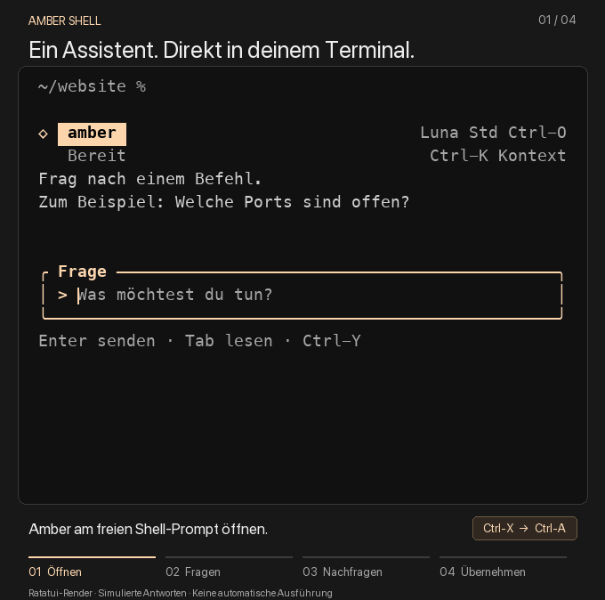

# amber-shell

Ein kompakter Terminalassistent für **macOS, Apple Terminal und Zsh**: Frage stellen, Erklärung lesen und den passenden Befehl in die editierbare Shell-Zeile übernehmen. Die offizielle Codex CLI nutzt dafür die vorhandene ChatGPT-Anmeldung.

[](https://www.rust-lang.org/)
[](https://ratatui.rs/)
[](#installation)
[](https://github.com/marcdon2002/homebrew-tap)
[](https://www.zsh.org/)
[](./LICENSE)
[](#modellwahl)

[Installation](#installation) · [Bedienung](#bedienung) · [Modellwahl](#modellwahl) · [Projektstruktur](#projektstruktur) · [Entwicklung](#entwicklung) · [Hilfe](#hilfe)

> [!TIP]
> **Ctrl-X, danach Ctrl-A** öffnet Amber direkt am Prompt. **Ctrl-Y** übernimmt den ausgewählten Befehl. Ausgeführt wird er erst durch ein separates normales **Enter in der Shell**. Escape oder Ctrl-C erhalten die vorherige Eingabe samt Cursor.



*Produktablauf aus der echten Ratatui-Oberfläche mit simulierten Antworten und beispielhaften Wartezeiten. Ctrl-Y übernimmt den Befehl als editierbaren Text; ausgeführt wird er erst mit Enter in der Shell.*

## Überblick

Amber bleibt als kleine Inline-Fläche im Terminal. Jeder Austausch bildet einen zusammengehörigen Block mit einer kurzen senkrechten Linie. „Du“ und „Amber“ kennzeichnen die Rollen; Fragen und Antworten beginnen an derselben Textkante, Befehle stehen leicht eingerückt darunter. Das kompakte Amber-Logo hebt sich mit einer eigenen Wortmarke und einem unabhängig animierten Statuszeichen ab. Die Eingabe behält ihren abgerundeten Rahmen. Die Höhe passt sich an den Inhalt an; längere Antworten und Befehle lassen sich mit den Pfeiltasten lesen. Modell und Fast-Modus bleiben rechts sichtbar.

Der Tab-Verlauf vereint frühere Amber-Fragen mit ihren Befehlsvorschlägen im gleichen Ordner und die letzten gefilterten Shell-Befehle. Rückfragen bleiben im laufenden Gespräch möglich. Ein neu geöffneter Dialog beginnt ein frisches Modellgespräch. Letzte Befehle und begrenzte Terminalausgaben stehen dabei als Kontext bereit, damit Amber auch Fehler direkt einordnen kann.

Amber schlägt zuerst den einfachsten passenden Standardbefehl vor: Auf „Wie liste ich alle Ordner auf?“ folgt `ls`. Zusätzliche Optionen und komplexere Varianten gibt es auf gezielte Nachfrage.

Für die Ausgabeerfassung läuft pro Terminal ein kleiner Rust-Helfer, der im Leerlauf auf Ereignisse wartet. Er hält die Ausschnitte ausschließlich im Speicher; pro Befehl startet kein zusätzlicher Erfassungsprozess. Codex startet für eine Anfrage und wird danach beendet.

## Installation

**Voraussetzungen:** macOS 13 oder neuer auf Apple Silicon, Zsh und die offizielle Codex CLI mit ChatGPT-Anmeldung. Die vorhandene Oh-My-Zsh-Konfiguration kann weiterverwendet werden.

### Mit Homebrew

```sh
brew install marcdon2002/tap/amber-shell
amber-shell-setup
```

Falls die offizielle Codex CLI noch fehlt:

```sh
brew install --cask codex
amber-shell login
```

Eine bestehende Codex-Installation samt Anmeldung wird weiterverwendet. Danach ein **neues Terminalfenster** öffnen und **Ctrl-X, danach Ctrl-A** drücken.

Homebrew lädt das fertige ARM64-Paket mit SHA256-Prüfung; eine Rust-Toolchain ist für die Installation nicht nötig. Die Distribution erfolgt über den eigenen [Homebrew-Tap](https://github.com/marcdon2002/homebrew-tap). Intel-Macs und Linux werden derzeit nicht als Homebrew-Paket angeboten.

`amber-shell-setup` sichert vorhandene `.zshenv` und `.zshrc`, ergänzt die markierten Amber-Blöcke und kann die bisherige Installation unter `~/.local` übernehmen. Es ersetzt ausschließlich unveränderte, vom Installer erzeugte Blöcke; eigene Anpassungen und Symlinks benötigen eine bewusste Zuordnung. Die Einbindung verweist auf Homebrews stabilen `opt`-Pfad, damit Updates keine erneute Einrichtung brauchen. Das Setup startet keine Modellanfrage.

Bei einer früheren Quellcode-Installation kann `~/.local/bin/amber-shell` im `PATH` vor Homebrew stehen. Der eingerichtete Hotkey verwendet ausdrücklich die Homebrew-Binary. Für direkte CLI-Aufrufe die alte Datei nach erfolgreicher Migration aus dem `PATH` nehmen oder `"$(brew --prefix amber-shell)/bin/amber-shell"` aufrufen.

Aktualisieren:

```sh
brew update
brew upgrade marcdon2002/tap/amber-shell
```

Danach ein neues Terminalfenster öffnen. Zum Deinstallieren zuerst die beiden markierten Amber-Blöcke aus `.zshenv` und `.zshrc` entfernen, dann `brew uninstall amber-shell` ausführen. Lokale Einstellungen und Verlauf bleiben erhalten.

### Aus dem Quellcode

Mit einer Rust-Toolchain gemäß [Cargo.toml](./Cargo.toml) im Repository-Ordner:

```sh
cargo build --release --locked
sh scripts/install.sh
```

Der Quellcode-Installer legt die Binary unter `~/.local/bin/amber-shell` und die Shell-Dateien unter `~/.local/share/amber-shell/` ab. Ein früher Block in `.zshenv` startet die Ausgabeerfassung; `.zshrc` lädt das ZLE-Widget nach der Prompt-Konfiguration. Persönliche Zsh-Startdateien werden weiterhin einmal geladen; nichtinteraktive Shells und Skripte bleiben ohne Erfassungshelfer.

<details>
<summary>Verlinkte Shell-Dateien oder abweichender Codex-Pfad</summary>

Bei einer verlinkten `.zshrc` oder `.zshenv` das jeweilige aufgelöste Ziel angeben; der Symlink bleibt erhalten:

```sh
amber-shell-setup --zshrc /absoluter/pfad/zur/zshrc
# Falls auch .zshenv verlinkt ist: zusätzlich --zshenv /absoluter/pfad/zur/zshenv
# Quellcode-Installation: dieselben Optionen an sh scripts/install.sh übergeben.
```

Standardmäßig liegt Codex unter `/opt/homebrew/bin/codex`. Für eine andere offizielle Installation vor dem Öffnen von Amber setzen:

```sh
export AMBER_CODEX_BIN="/absoluter/pfad/zu/codex"
```

Der Hotkey lässt sich über `AMBER_SHELL_KEY` vor dem Laden des Plugins anpassen. Vorhandene Tastenzuweisungen werden nicht überschrieben.

</details>

<details>
<summary>Ohne dauerhafte Shell-Einbindung ausprobieren</summary>

```sh
export AMBER_SHELL_BIN="$PWD/target/release/amber-shell"
source shell/amber-shell.zsh
```

Diese Einbindung gilt nur in der aktuellen Shell und erfasst keine bereits vergangenen Ausgaben. Um auch den Erfassungshelfer ohne Installation auszuprobieren, eine eigene Shell starten und dort das Plugin laden:

```sh
"$AMBER_SHELL_BIN" session -- /bin/zsh -i
# In dieser Shell, weiterhin im Repository-Ordner:
source shell/amber-shell.zsh
```

Für eine netzwerkfreie Demo:

```sh
export AMBER_SHELL_SIMULATE=1
```

Danach den normalen Hotkey verwenden. Die Simulation ist als **SIM** gekennzeichnet und verwendet einen eigenen lokalen Verlauf. `unset AMBER_SHELL_SIMULATE` beendet den Demomodus für spätere Aufrufe.

</details>

## Bedienung

| Taste | Aktion |
| --- | --- |
| Ctrl-X, danach Ctrl-A | Amber am Shell-Prompt öffnen |
| Enter | Frage oder Rückfrage senden |
| Ctrl-Y | Ausgewählten vollständigen Befehl in die Shell übernehmen |
| Tab | Zwischen Frage und Verlauf wechseln |
| ↑ / ↓ im Verlauf | Lesen und scrollen |
| ← / → im Verlauf | Amber-Vorschlag oder Shell-Befehl auswählen |
| Enter im Verlauf | Gewählten Befehl in die Shell übernehmen |
| Ctrl-O | Modellwahl öffnen |
| Ctrl-F im Modellpicker | Fast-Modus umschalten, sofern unterstützt |
| Ctrl-K | Freiwilligen Zusatzkontext einstellen |
| Ctrl-E | Wieder der neuesten Ausgabe folgen |
| Escape / Ctrl-C | Abbrechen; ursprüngliche Shell-Eingabe erhalten |

**Übernahme und Ausführung bleiben getrennt.** Auch mehrzeilige Befehle werden als editierbarer Text übernommen. Die sichtbare Markierung gehört nicht zum Befehl. Während einer Antwort kann bereits eine Rückfrage vorbereitet werden.

### Kontext und Verlauf

**Automatisch** ist die Voreinstellung: Amber erhält den aktuellen Ordner, letzte geeignete Shell-Befehle und erfasste Ausgaben mit Exit-Status. Die feste Grenze von drei Ausgaben entfällt. Stattdessen entscheidet ein Größenbudget, wie viele Schritte erhalten bleiben; lange Ausgaben werden auf ihren letzten Teil gekürzt und markiert. Bereits bei einer Ausgabe aufgeführte Befehle werden nicht nochmals als Shell-History angehängt.

Bei einer Projektfrage ergänzt Amber passende Informationen aus dem aktuellen Ordner, seinen Unterordnern und übergeordneten Manifesten innerhalb des Git-Projekts. Bei „Wie starte ich das npm Webprojekt?“ kann das etwa `apps/web/package.json` mit den tatsächlichen Skripten und dem Paketmanager aus dem Workspace sein. `package.json` wird auf relevante Felder verdichtet; Quellcode, Lockfile-Inhalte und vollständige Abhängigkeitsbäume werden nicht gelesen. Bei einer einfachen Frage wie „Wie liste ich Ordner auf?“ entfällt die Projektsuche.

**Ctrl-K** bietet eine einzige, lokal gespeicherte Wahl:

| Taste | Modus | Wirkung |
| --- | --- | --- |
| A | Automatisch | Terminalkontext und bei Projektfragen passende Projektinfos |
| T | Nur Terminal | Ordner, Befehle und erfasste Ausgaben; keine Projektdateien |
| X | Aus | Keinen neuen Zusatzkontext mitsenden |

**Tab** zeigt den tatsächlichen Anhang zur aktuellen Eingabe; Enter oder Escape kehrt zur Frage zurück. Die Auswahl gilt ab der nächsten Frage und bleibt beim erneuten Öffnen erhalten. Bereits versendete Informationen bleiben im laufenden Gespräch; zum Neustart Amber schließen und erneut öffnen.

Die Suche startet erst bei einer Projektfrage und wird im Dialog wiederverwendet. Es gibt keinen permanenten Dateiindex, Hintergrundscanner oder zusätzlichen Modellaufruf. Ignorierte Verzeichnisse, `node_modules`, Buildordner und Symlinks werden übersprungen. Git-Ignore-Regeln gelten auch in Ordnern ohne Repository. Bei einer begrenzten Suche weist Amber darauf hin; ein Wechsel in den konkreten Unterordner grenzt große Projekte weiter ein.

<details>
<summary>Such- und Größenlimits</summary>

- Terminalring: höchstens **24 KiB serialisiert**, ohne feste Anzahl; je Befehl bis **4 KiB Ausgabetail**. Der Modellanhang erhält davon bis **12 KiB**, bei Bedarf mit weiter gekürzten Ausgaben.
- Shell-History: letzte bis zu **20 geeignete Befehle**, höchstens **8 KiB**.
- Projektsuche: bis **4 Unterordnerebenen**, **96 Verzeichnisse**, **1.024 Einträge**, **24 kleine Manifest-/Dokumentationsdateien** und ein Zeitbudget von **150 ms** zwischen Dateioperationen.
- Pro Frage: höchstens **4 Projektdateiauszüge** mit insgesamt **8 KiB** einschließlich JSON-Escaping und Dateimarkierungen. Der ganze neue Kontextanhang bleibt auf **48 KiB** begrenzt.
- Erlaubte Dateien: `package.json`, `Cargo.toml`, `pyproject.toml`, `go.mod`, `Makefile`, `justfile`, `README.md` und `README`. README-Auszüge werden nur bei entsprechenden Fragen ergänzt. Die Suche ist keine vollständige Quellcodeanalyse.

</details>

Die Ausgabeerfassung beginnt mit einer neuen Terminal-Sitzung. Sie hält die Ausschnitte ausschließlich im Arbeitsspeicher und schreibt kein Ausgabelog. Beim Öffnen von Amber wird ein Schnappschuss abgefragt; beim Schließen der Shell verschwinden die Ausschnitte. Interaktive Eingaben, erkannte Vollbildansichten, Geheimnisse und sensible Pfade werden ausgelassen; die Filter sind heuristisch. Der gemeinsame Terminalstrom enthält Standard- und Fehlerausgabe, möglicherweise mit Hintergrundausgaben. In Dateien umgeleitete Ausgaben fehlen.

Der lokale Amber-Verlauf hält insgesamt höchstens **20 abgeschlossene Antworten und 128 KiB**. Er wird nach dem aktuellen Ordner gefiltert. Das reine Lesen alter Einträge hängt sie nicht automatisch an eine neue Modellanfrage an. Die Shell-History liefert Befehle; Ausgabeausschnitte stammen ausschließlich aus der laufenden Erfassungssitzung und werden nicht im Antwortverlauf gespeichert.

<details>
<summary>Darstellung und lokale Dateien</summary>

- `NO_COLOR=1` deaktiviert Farben.
- Die Standardansicht verwendet kurze senkrechte Linien und den abgerundeten Eingaberahmen. `AMBER_SHELL_ASCII=1` aktiviert einfache ASCII-Zeichen für Rahmen und Markierungen; `AMBER_SHELL_ASCII=0` verwendet die Standardansicht.
- `AMBER_SHELL_REDUCED_MOTION=1` deaktiviert die Aktivitätsanimation.
- `AMBER_SHELL_CAPTURE=0 /bin/zsh -il` startet eine neue Shell ohne Ausgabeerfassung. Mit Ctrl-K und X lässt sich neuer Zusatzkontext vollständig ausschalten.
- Die Inline-Fläche wächst auf höchstens 20 Zeilen; ab 18 Fensterzeilen belegt sie maximal drei Viertel der Höhe.
- Einstellungen und Verlauf liegen unter `${XDG_CONFIG_HOME:-$HOME/.config}/amber-shell/`. Eigene Dateien sind privat und werden atomar gespeichert.
- `settings.json` speichert Modell, Fast-Modus und Kontextwahl; `history.json` die abgeschlossenen Amber-Antworten. Simulationsdaten liegen getrennt.

</details>

## Modellwahl

**GPT-6 Luna (`gpt-6-luna`) ist der Standard.** Ctrl-O lädt den Modellkatalog des vorhandenen Codex-Kontos. Pfeiltasten wählen, Enter speichert Modell und Fast-Modus gemeinsam; Escape verwirft die Änderung. Ein Wechsel gilt ab der nächsten Frage und ist während einer laufenden Antwort gesperrt.

Fast ist ein optionaler Dienstmodus und wird nur für unterstützte Modelle angeboten. Er kann mehr Kontingent verbrauchen; der Picker zeigt den Hinweis an. Die aktuellen Bedingungen stehen in der [offiziellen Codex-Dokumentation](https://learn.chatgpt.com/docs/agent-configuration/speed).

Amber verändert weder die allgemeine Codex-Konfiguration noch dessen Auth-Dateien. Die Anmeldung bleibt bei der offiziellen CLI; es gibt keinen API-Key-Fallback oder stillen Wechsel auf ein anderes Modell.

## Projektstruktur

```text
src/
├── main.rs                 CLI und Start des Dialogs
├── model.rs                Eingabe, Gespräch und Befehlsauswahl
├── ui.rs                   Kompakte Terminaldarstellung
├── terminal.rs             Ereignisse, Resize und Wiederherstellung
├── provider.rs             Offizieller Codex-App-Server
├── context.rs              Begrenzter, einsehbarer Zusatzkontext
├── projects.rs             Gezielte Suche und kompakte Projektinfos
├── capture.rs              Gefilterter Ausgabering im Speicher
├── session.rs              Ereignisgesteuerte PTY-Erfassung
├── history.rs              Privater lokaler Antwortverlauf
└── settings.rs             Modell-, Fast- und Kontext-Einstellungen
shell/amber-shell.zsh       ZLE-Widget und sichere Befehlsübernahme
shell/amber-session.zsh     Früher Start der Ausgabeerfassung
scripts/                   Installation und Demo-Erzeugung
examples/render_frames.rs  Reproduzierbare Renderer-Frames
tests/                     Rust-, Terminal- und ZLE-Prüfungen
assets/amber-demo.gif       Eingebettete Terminalanimation
LICENSE                     MIT-Lizenz
```

Quellcode, Tests, Lockdatei, README und Demo-Animation bilden den veröffentlichten Stand. Interne Dokumente und Prüfberichte unter `docs/`, Arbeitsdateien, Build-Ausgaben, lokale History und Zugangsdaten bleiben über [`.gitignore`](./.gitignore) ausgeschlossen.

## Entwicklung

Für eine Codeänderung:

```sh
cargo fmt --check
cargo clippy --all-targets --locked -- -D warnings
python3 tests/install_e2e.py
cargo test --locked
```

Die Terminalprüfungen verwenden eigene PTYs, synthetische Eingaben und temporäre Profile:

```sh
python3 -m pip install --target work/testdeps -r tests/requirements.txt
cargo build --locked
python3 tests/pty_e2e.py
python3 tests/terminal_e2e.py
python3 tests/zle_binary_e2e.py
python3 tests/session_e2e.py
python3 tests/session_bootstrap_e2e.py
```

Tests mit echten Modellanfragen sind ausdrücklich opt-in. Im normalen Testlauf werden sie ausgelassen.

Die README-Animation enthält ausschließlich Demo-Daten aus dem tatsächlichen Ratatui-Renderer:

```sh
TERM=xterm-256color cargo run --locked --example render_demo -- work/product-demo/timeline.json
python3 scripts/render-demo.py --input work/product-demo/timeline.json
```

Zwischendateien bleiben unter `work/`; nur die fertige Animation unter `assets/amber-demo.gif` wird versioniert.

### Homebrew-Releases pflegen

Der [Release-Workflow](./.github/workflows/release.yml) testet und baut Amber automatisch auf einem normalen ARM64-macOS-Runner, sobald ein Versions-Tag wie `v0.7.3` gepusht wird. Der Tag muss zur Version in `Cargo.toml` passen. Der Workflow verwendet ausschließlich synthetische Tests ohne Modellanfragen.

Nach dem Aktualisieren der Version in `Cargo.toml` und `Cargo.lock`, den lokalen Tests und dem Commit:

```sh
git tag -a vX.Y.Z -m "Amber Shell X.Y.Z"
git push origin main refs/tags/vX.Y.Z
```

Ein erfolgreicher Lauf veröffentlicht das Installationsarchiv, `SHA256SUMS` und die aus genau diesem Build erzeugte `amber-shell.rb` als GitHub-Release. Er benötigt nur den GitHub-Token des Amber-Repositories. Bestehende Release-Dateien werden nicht überschrieben. Ein manueller Start unter **Actions → Release → Run workflow** prüft und baut den gewählten Stand, ohne ein Release zu veröffentlichen.

Anschließend **die aus diesem Release erzeugte** Formel als `Formula/amber-shell.rb` im [Homebrew-Tap](https://github.com/marcdon2002/homebrew-tap) aktualisieren. Dieser separate Schritt bleibt bewusst beim Maintainer; ein zusätzlicher Zugang zum Tap wird nicht im Amber-Repository hinterlegt. Der Tap prüft Änderungen automatisch mit einer echten Homebrew-Installation, `brew test` und `brew audit --strict`. Der Formulartest richtet die Shell nur in einem temporären Testordner ein.

Für lokale Paketprüfungen bleibt der [Release-Packager](./scripts/package-release.py) verfügbar:

```sh
MACOSX_DEPLOYMENT_TARGET=13.0 cargo build --release --locked
python3 scripts/package-release.py
(cd work/release && shasum -a 256 -c SHA256SUMS)
```

Das Archiv enthält ausschließlich Binary, Shell-Integration, Installer und MIT-Lizenz. Die Binary muss zur Version in `Cargo.toml` passen. Interne Unterlagen und Arbeitsdateien bleiben ausgeschlossen.

## Hilfe

Loginstatus und CLI-Version prüfen:

```sh
amber-shell doctor
amber-shell login
# Quellcode-Installation ohne PATH-Eintrag: ~/.local/bin/amber-shell verwenden.
```

Nach einem Update ein neues Terminalfenster öffnen, damit auch der Erfassungshelfer aktualisiert wird. Bei Problemen mit Netzwerk, Kontolimit oder Modellberechtigung bleibt die Shell-Eingabe erhalten. Kann die Ausgabeerfassung beim Start nicht eingerichtet werden, startet die normale Shell weiter.

Fehler und Vorschläge können im [Issue-Tracker](https://github.com/marcdon2002/amber-shell/issues) festgehalten werden.

## Lizenz

Amber Shell steht unter der [MIT-Lizenz](./LICENSE).
